<p align="center">
  
</p>

<p align="center">
  
</p>

<p align="center">
  
  
  
  
</p>

## Overview

End-of-studies capstone archive combining a Laravel HR and leave-management application (GRH Congee) with a data-warehouse study: ETL pipeline, star schema, UML models, SQL scripts and the final report. The repository is the reference collection for the project’s code and deliverables.

## Highlights

- GRH Congee Laravel application for HR and leave management
- ETL pipeline and star-schema data warehouse design
- UML class, sequence and use-case models
- SQL schema and analytical datasets
- Final report and defence material

## Tech stack

<p align="center">
  
</p>

## Getting started

**Prerequisites:** PHP 8.2+, Composer and MySQL for the GRH application.

```bash
cd "GRH Congee"
composer install
cp .env.example .env
php artisan key:generate
php artisan migrate
php artisan serve
```

## Project structure

```text
GRH Congee/          Laravel HR application
final.sql            database schema and data
*.csv                ETL source extracts
*.mdj, *.png         UML models and diagrams
final rapport .pdf   capstone report
```

---

<p align="center">
  
</p>

<p align="center">
  Built by <a href="https://github.com/Skander-Bardaoui"><b>Skander Bardaoui</b></a> ·
  <a href="https://skander-bardaoui.netlify.app/">Portfolio</a> ·
  <a href="https://github.com/Skander-Bardaoui?tab=repositories">All repositories</a>
</p>
